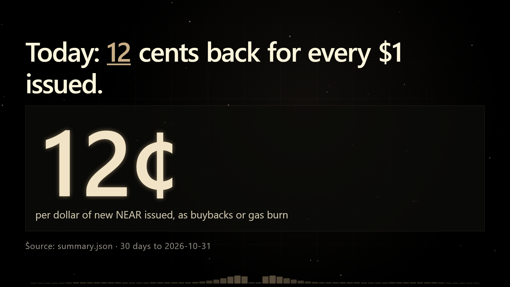
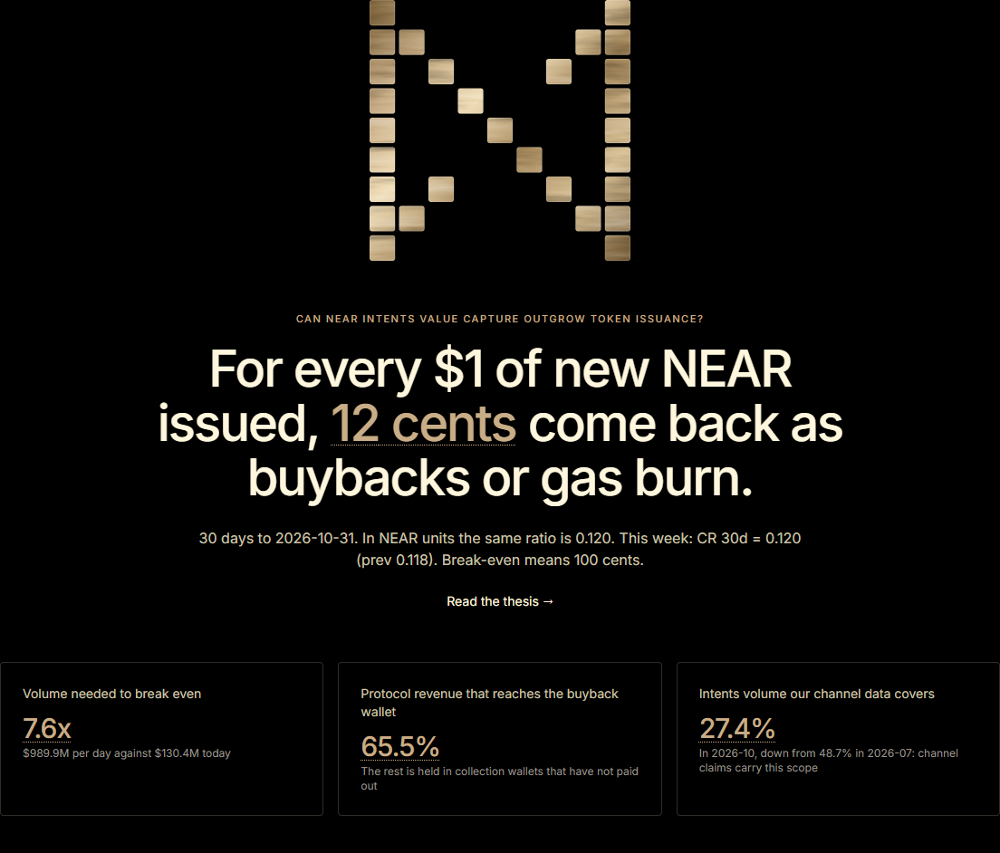
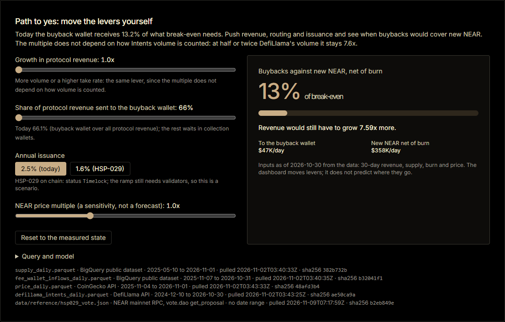
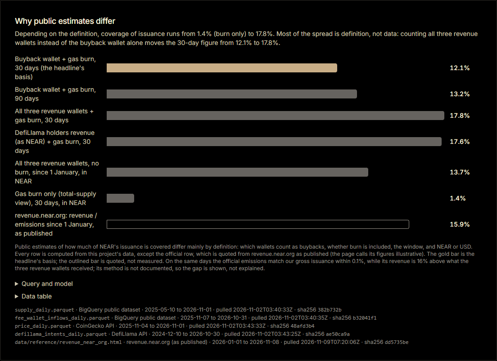
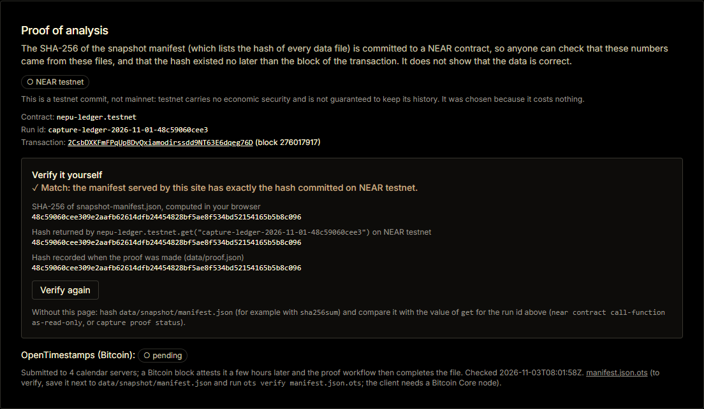
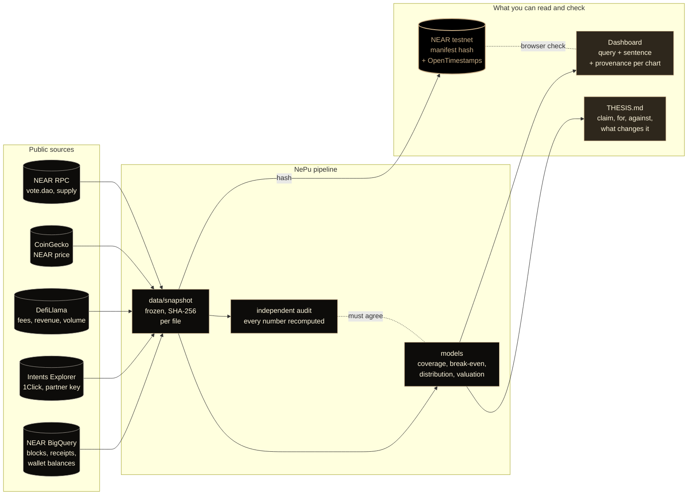

<p align="center">
  <a href="https://axlnd3r.github.io/NePu/"></a>
</p>

<p align="center">
  
  
  
  
  
</p>

<p align="center">
  <b>Can NEAR Intents value capture outgrow token issuance? A ledger that answers from the chain, and lets you check it back.</b>
</p>

<p align="center">
  <a href="https://axlnd3r.github.io/NePu/"><b>Live dashboard</b></a> ·
  <a href="https://axlnd3r.github.io/NePu/#path"><b>Path to yes</b></a> ·
  <a href="THESIS.md"><b>Thesis</b></a> ·
  <a href="https://axlnd3r.github.io/NePu/methodology/#proof"><b>Verify the proof</b></a> ·
  <a href="https://x.com/Axlnd3r/status/2118168310374453512"><b>Demo post on X</b></a> ·
  <a href="docs/METHODOLOGY.md"><b>Methodology</b></a> ·
  <a href="DATA_AUDIT.md"><b>Sources checked</b></a>
</p>

<p align="center">
  <a href="site/public/media/nepu-demo.mp4"></a>
  <br><sub>The demo: the gap, what closes it, and the proof. Every figure on screen is read from the same JSON as the dashboard. Also <a href="https://x.com/Axlnd3r/status/2118168310374453512">on X</a>.</sub>
</p>

## What it is
**NePu (NEAR Capture Ledger)** is a reproducible investment thesis for NEAR, built for NEAR
HACKATHON 2026 in the Investment Thesis track, which is judged on the evidence rather than the
conviction. It asks one falsifiable question: can the value NEAR Intents captures for the token
(fee revenue that buys NEAR back, plus gas burn) outgrow the new NEAR issued every epoch, and how
far is the network from that point today?

It answers from NEAR's own chain. Fee revenue is traced as it leaves `intents.near` for the revenue
wallets, issuance and burn come from block data, channels come from the Intents Explorer, and every
figure is reconciled with DefiLlama before it is shown. One command rebuilds every metric, chart
and the thesis text from committed, hashed data; a second, independent implementation in the tests
recomputes every published number; and the hash of the inputs is committed to NEAR so anyone can
check that the numbers came from these files. No price is predicted.

For tools and agents: `make build` writes machine-readable outputs to `site/public/data/*.json`
(summary, coverage, distribution, valuation, developer, usage, markers, provenance, queries) and
regenerates `THESIS.md` and the results block below; `data/snapshot/manifest.json` is the index of
the inputs; the `capture` command (`uv run capture --help`) is the entry point.

<table>
  <tr>
    <td width="50%" valign="top"><a href="https://axlnd3r.github.io/NePu/"></a><br><b>The headline, with its evidence</b><br><sub>Click any number on the dashboard for its formula, tables and date.</sub></td>
    <td width="50%" valign="top"><a href="https://axlnd3r.github.io/NePu/#path"></a><br><b>Path to yes</b><br><sub>Move revenue, routing, the issuance cut and price; see when buybacks would cover new NEAR.</sub></td>
  </tr>
  <tr>
    <td width="50%" valign="top"><a href="https://axlnd3r.github.io/NePu/#definitions"></a><br><b>Why public estimates differ</b><br><sub>The same days under every definition in use, next to the official dashboard's figure.</sub></td>
    <td width="50%" valign="top"><a href="https://axlnd3r.github.io/NePu/methodology/#proof"></a><br><b>Anyone can verify</b><br><sub>Your browser hashes the served manifest and reads the contract on NEAR testnet.</sub></td>
  </tr>
</table>

## How it fits together



## The problem
NEAR Intents routes large cross-chain swap volume, and part of its fees is used to buy NEAR, while
new NEAR is issued every epoch. Whether that capture can outgrow issuance is a falsifiable question.
This project measures it and reports how far the network is from that point:

- Coverage ratio: `CR = (buyback value + burn value) / gross issuance value`, per day and over rolling
  `30d` and `90d` windows, in USD and in NEAR units.
- Break-even daily Intents volume: `V* = (i * S * P - Burn_usd) / tau_eff`, with `i` the daily
  issuance rate, `S` total supply, `P` the NEAR price and `tau_eff` the take rate. Because the
  buyback revenue is measured on chain, `V* / V0` is the same whatever volume definition is used:
  it is the growth in buyback revenue that break-even needs.
- Buybacks are not burns: the NEAR bought back is held in a wallet, so the float view and the
  total-supply view are kept apart.

## Results
<!-- results:start -->
**Latest build**, generated from `site/public/data/*.json` (the full argument, with the evidence against it, is in [THESIS.md](THESIS.md)):

- For every dollar of new NEAR issued, **12 cents** came back as buybacks or gas burn in the 30 days to 2026-10-31.
- **Not yet:** daily Intents volume would have to reach $989.9M, 7.6x its $130.4M average, for capture to cover issuance at today's rates (9.2x at the prices of the window the cents use).
- That multiple does not depend on how volume is counted: at half or twice DefiLlama's volume it stays 7.6x. It is the growth in buyback revenue that break-even needs.
- The track's example hypothesis, that Intents volume leads network usage better than price: not supported out of sample; daily active accounts fell 33% while Intents volume rose 72%.
- The issuance cut HSP-029, read on chain from `vote.dao`: status `Timelock`, 99.97% of the veNEAR cast for one option, timelock ends 2026-11-16T16:48:08Z. It would close 1.58x of the gap once validators adopt it.
- Proof: the SHA-256 of the snapshot manifest is committed on NEAR **testnet** (contract `nepu-ledger.testnet`, run id `capture-ledger-2026-11-01-48c59060cee3`, [transaction](https://explorer.testnet.near.org/transactions/2CsbDXKFmFPqUpBDvQxiamodirssdd9NT63E6dqeg76D), block 276,017,917). OpenTimestamps (Bitcoin): confirmed.
<!-- results:end -->

## Quickstart (offline)
No credentials are needed. Requirements: [uv](https://docs.astral.sh/uv/) (it installs the pinned
`Python 3.12` itself if that is missing), `Node 24`, GNU make, git. Tested on Windows and Linux.

1. **Do** `git clone https://github.com/Axlnd3r/NePu.git` and `cd NePu`.
   **See** the repository with `data/snapshot/` (the frozen inputs) and `data/snapshot/manifest.json`.
2. **Do** `make all`. **See** it install dependencies (the only step that needs a network), rebuild
   every metric into `site/public/data/`, run ruff, the manifest hash check and the tests, and
   export the dashboard to `site/out/`. It ends without errors.
3. **Do** `make serve` (it runs `uv run python -m http.server 8000 --directory site/out`) and open
   `http://localhost:8000`. **See** the hero sentence quoted under Results, what NePu is and how it
   works, the ledger of where Intents volume goes, the Path to yes sliders, the break-even meter
   and the other pages. (Opening `site/out/index.html` straight from the disk shows a broken page,
   with no styles and no charts: the export uses absolute asset paths, so it must be served.)
4. **Do** `uv run capture verify-manifest data/snapshot`. **See** `data/snapshot/manifest.json: OK`:
   every input file still has the hash recorded when it was frozen.
5. **Do** move the sliders under "Path to yes". **See** the share of break-even and the revenue
   growth still needed change; "Reset to the measured state" puts back the values from the data.

| Command | What it does |
|---|---|
| `make setup` | install Python (uv) and Node dependencies |
| `make build` | rebuild every metric from `data/snapshot/`, and `THESIS.md` and the results block |
| `make verify` | lint, recompute manifest hashes, run the tests (including the independent number audit) |
| `make site` | build the static dashboard into `site/out/` |
| `make serve` | serve `site/out` at `http://localhost:8000` (the export must be served, not opened from disk) |
| `make qa` | open every page in Chrome (desktop and phone), check the interactive parts against the data, fail on console errors, failed requests or overflow; screenshots go to `qa/screenshots/` |
| `make proof` | commit the manifest hash to NEAR (see Verify the proof) |
| `make all` | setup, build, verify and site; works from a clean clone, offline |

## Live mode
Needs credentials, so it is optional; the offline quickstart never uses it. Names only are listed in
`.env.example`; real values live in `.env`, which is git-ignored.

1. Copy `.env.example` to `.env` and fill in `GOOGLE_CLOUD_PROJECT` (and `BQ_MAX_BYTES`). Log in once
   with `gcloud auth application-default login`. `INTENTS_EXPLORER_JWT` and `COINGECKO_API_KEY` are
   optional; without the JWT the Explorer tables are skipped.
2. `uv run capture extract --dry-run` estimates BigQuery bytes without pulling anything.
3. `make extract` pulls into `data/live/` (git-ignored). It is incremental by date: a second run
   queries nothing that is already there. BigQuery bills your own project's quota.
4. `make build-live` rebuilds the metrics from `data/live/`.
5. `uv run capture snapshot --freeze <YYYY-MM-DD>` copies `data/live/` into `data/snapshot/` (rows up
   to that complete UTC day) and rewrites its manifest.
6. `uv run capture reference hsp029`, `uv run capture reference official` and
   `uv run capture reference buyback-flows` refresh the reference files in `data/reference/` (the
   on-chain vote, the official dashboard page and the buyback wallet's activity), each with its
   manifest entry. None needs a key.

`.github/workflows/weekly-rebuild.yml` does these steps weekly when its repository secrets are set
(it does nothing without them).

## Verify the proof
The SHA-256 of `data/snapshot/manifest.json` (which lists the hash of every input file) is committed
to a NEAR contract, `contracts/proof-of-analysis`, so anyone can check that the published numbers
came from these files and that the hash existed no later than the transaction's block. **It does
not show that the data is correct**, and it is on **testnet**, which carries no economic security
and does not promise to keep its history; it was chosen because it costs nothing. The network is
named wherever the proof is shown. The result block above gives the contract, the run id and the
transaction.

- **On the dashboard:** the Methodology page hashes the served manifest in your browser, reads the
  contract's `get(run_id)` over JSON-RPC and compares the two.
- **With this repository:** `sha256sum data/snapshot/manifest.json`, then
  `PROOF_ACCOUNT_ID=nepu-ledger.testnet uv run capture proof status`, which prints `MATCH` when the
  contract holds that hash.
- **With nothing but curl:** call the contract's view method `get` with the run id; the reply holds
  the hash as JSON bytes:

```sh
ARGS=$(printf '{"run_id":"<run id from the results block>"}' | base64 -w0)
curl -s https://rpc.testnet.fastnear.com -H 'content-type: application/json' -d "{\"jsonrpc\":\"2.0\",\"id\":1,\"method\":\"query\",\"params\":{\"request_type\":\"call_function\",\"finality\":\"final\",\"account_id\":\"nepu-ledger.testnet\",\"method_name\":\"get\",\"args_base64\":\"$ARGS\"}}"
```

- **Second, independent timestamp:** the manifest is also stamped with OpenTimestamps (Bitcoin). The
  stamp is made by `.github/workflows/proof.yml`, because the `ots` client does not run on Windows.
  Save `data/proof/<run id>/manifest.json.ots` next to the manifest and run `ots verify`; the client
  needs a Bitcoin Core node. A fresh stamp is pending for a few hours.
- **Pre-registered forward tests:** [`data/prereg/PREREG.md`](data/prereg/PREREG.md) lists tests
  written before their windows closed (what each window already held is stated there), each with
  its quantity, window and pass rule
  (bands derived from the values measured at registration, never a price). The SHA-256 of
  `data/prereg/manifest.json` is committed to the same contract with `capture prereg anchor` and
  stamped by the proof workflow; `capture prereg score` scores each test once its window has closed
  and the result is shown on the dashboard, a miss included.
- **The contract** is built and tested in CI (`.github/workflows/contract.yml`); the wasm and its
  checksum are committed in `contracts/proof-of-analysis/artifacts/`. To re-run the proof yourself you
  need `near-cli-rs`, a dedicated NEAR account and, for the weekly job, a function-call key limited
  to the `commit` method; see `.env.example`. Never use your own wallet, and never put a private key
  in the repository.

## Dashboard and demo video
- Dashboard: https://axlnd3r.github.io/NePu/ (seven pages; every chart shows its query, one plain
  sentence and its provenance). The Overview opens with what NePu is, a step-by-step tour of how it
  works, the demo video, and the interactive Path to yes.
- Demo video: rendered from the Remotion project in [`video/`](video/README.md), so every figure on
  screen comes from the same JSON; the square cut is in
  [`site/public/media/nepu-demo.mp4`](site/public/media/nepu-demo.mp4) and the post is
  [on X](https://x.com/Axlnd3r/status/2118168310374453512).

## Methodology
Formulas, definitions and limitations: [docs/METHODOLOGY.md](docs/METHODOLOGY.md). The thesis with the
contrary evidence, the numeric conditions that would change it, why public estimates differ, and the
metrics that are unavailable: [THESIS.md](THESIS.md).

## Data sources
BigQuery public dataset `bigquery-public-data.crypto_near_mainnet_us`, the NEAR Intents Explorer API,
DefiLlama, CoinGecko and the 1Click token list; for reference, the House of Stake contract `vote.dao`
(read over NEAR RPC), the official revenue dashboard revenue.near.org (quoted as published) and the
NearBlocks API (the buyback wallet's activity). How each was checked, and where a source fell short,
is recorded in [DATA_AUDIT.md](DATA_AUDIT.md).

## Limitations
Stated in full in [THESIS.md](THESIS.md). In short: the channel data covers 1Click transactions only
and a shrinking share of Intents volume; the buyback wallet is observed only from the day it first
appears; the volume growth in the historical scenarios comes from the launch phase; the NEAR price is
held constant in every simulation, which is an assumption and not a forecast; correlation is not
causation; no price is predicted.

## Track checklist
Mapped to the official sources: the `thesis` row and the screening rules of
[HACKATHON.md](https://nearhackathon.com/HACKATHON.md), and the track's example prompt
([`02-thesis.md`](https://github.com/nearai/near-hackathon-prompt-examples/blob/main/tracks/02-thesis.md)).
The last items are our own additions.

| Official ask | Where it is in NePu |
|---|---|
| SQL against the NEAR BigQuery public dataset for daily active accounts, transaction counts and contract usage, always filtered on `block_date` | [`sql/network_daily.sql`](sql/network_daily.sql), [`sql/intents_onchain_daily.sql`](sql/intents_onchain_daily.sql), [`sql/contracts_daily.sql`](sql/contracts_daily.sql), shown on the [Network usage](https://axlnd3r.github.io/NePu/network/) and [Developer](https://axlnd3r.github.io/NePu/developer/) pages; all of [`sql/`](sql/), dry-run first and run under a byte cap; the one exception (`epoch_date`, a table without `block_date`) is stated in the file and in [DATA_AUDIT.md](DATA_AUDIT.md) |
| The example hypothesis: Intents volume leads network usage better than token price, with the evidence against | the [Network usage](https://axlnd3r.github.io/NePu/network/) page and [THESIS.md](THESIS.md): tested out of sample and reported as it came out |
| A pull from the NEAR Intents Explorer API with a JWT in `.env` | [`src/capture/extract/intents_explorer.py`](src/capture/extract/intents_explorer.py); the frozen 1Click tables are in `data/snapshot/` |
| One command that rebuilds every chart from raw data | `make all`, offline, from a clean clone, no credentials |
| A static dashboard: each chart, the query behind it, one plain sentence | [the dashboard](https://axlnd3r.github.io/NePu/): every card has the sentence, "Query and model" and the provenance of each file |
| `THESIS.md` with the claim, evidence for, evidence against, what would change my mind | [THESIS.md](THESIS.md), generated from the data; numeric triggers re-evaluated on every build |
| Never invent numbers; write what cannot be computed | every number is a registered fact traced to a hashed file; "Unavailable metrics and why" in [THESIS.md](THESIS.md) |
| A README a machine can follow: what it is, the problem, "do X, see Y" | this file, Quickstart (offline) |
| A public demo post on X with the video | [the post](https://x.com/Axlnd3r/status/2118168310374453512) |

- [x] Our own: every published number recomputed by an independent implementation (`tests/test_numbers_audit.py`)
- [x] Our own: the manifest hash committed to NEAR testnet and stamped with OpenTimestamps
- [x] Our own: the on-chain revenue reconciled with DefiLlama month by month, with a test that withdraws the headline if it fails
- [x] Our own: `make all` from a fresh clone with no credentials, run by a separate AI screener session (a fresh agent that had not seen this project's history); it passed
- [ ] The same run by a human reviewer (pending)

## AI & libraries disclosure
- The code, tests and documentation were written with Claude Code (Anthropic), using the Claude
  models named in the commit trailers (`Claude Sonnet 5.5`, `Claude Opus 5.5` and `Claude Haiku 5.5`),
  under the author's direction. The author made the decisions about scope and about anything
  involving money or public transactions, and ran those transactions.
- Python: duckdb, pandas, pyarrow, google-cloud-bigquery, httpx, python-dotenv, numpy, scipy, typer;
  development: pytest, ruff (exact versions in `uv.lock`).
- Site: next, react, react-dom, recharts, Tailwind CSS, TypeScript, the Inter typeface
  (@fontsource-variable/inter, SIL Open Font License, self-hosted so the build stays offline),
  and Playwright for the QA and the README screenshots (exact versions in `site/package-lock.json`).
- Contract: near-sdk, built with cargo-near; deployed and called with near-cli-rs. The
  OpenTimestamps client (`opentimestamps-client`) runs in CI.
- Badges in this README are served by shields.io. Data providers are listed under Data sources.

## Hackathon diff
Work done during the hackathon, from the planning-only tag to the submission:
https://github.com/Axlnd3r/NePu/compare/pre-hackathon...hackathon-submission
(the `hackathon-submission` tag is created when the project is submitted; until then, the same
comparison against the current state is
https://github.com/Axlnd3r/NePu/compare/pre-hackathon...main).

- Tag `pre-hackathon`: planning documents only (`CLAUDE.md`, `PROGRESS.md`, runbook commands).

## Layout
- `sql/`: one parameterised query per BigQuery table; `src/capture/`: extractors, models
  (coverage, break-even, distribution, valuation, developer, usage, ledger), build, thesis, proof, CLI.
- `data/snapshot/`: committed daily aggregates and `manifest.json`; `data/reference/`: dated events,
  policy parameters, the on-chain HSP-029 vote, the official dashboard page and the buyback wallet's
  activity, with their own manifest; `data/proof.json` and `data/proof/`: the proof record.
- `site/`: Next.js and Recharts, static export, reads `site/public/data/*.json`.
- `contracts/proof-of-analysis/`: the NEAR contract.
- `tests/`: unit, golden, invariant, reconciliation, manifest and independent audit tests.
- `docs/media/readme/`: the banner and the screenshots above (`node qa/readme-shots.mjs`).

## License
MIT.
